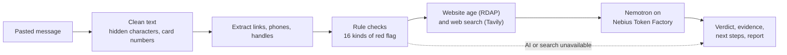

# Scam Message Checker


**Paste a suspicious message. Get a verdict, the evidence behind it, what to do next, and a ready-to-send report.**

| | |
|---|---|
| **Live demo** | https://scam-checker-jzvvktrahqftfcappgwkbws.streamlit.app/ |
| **Demo video** | YOUTUBE-LINK |
| **Hackathon / track** | Nebius x NVIDIA Global AI Hackathon 2026 / Best Apps and Agents |
| **Entry** | Solo |
| **License** | MIT |


## Why it is different

Most scam checkers stop at "the AI says scam". This one:

1. **Shows its evidence.** The words that triggered a rule are highlighted, it checks how new each website is, and it shows related warnings from the web.
2. **Is measured, and shows its mistakes.** It was tested on 100 messages plus 4,827 real normal texts. The misses and false alarms are published below, not hidden.
3. **Does not trust the AI blindly.** Cheap, predictable rule checks run first. If the AI is fooled into saying "probably safe" while the rules found strong warning signs, the verdict is raised.
4. **Is hardened.** The message is treated as hostile input: prompt-injection defence, hidden characters removed, links never clickable, card numbers hidden before anything is sent anywhere.
5. **Turns a verdict into action.** It lists next steps and writes a report message you can copy and send, with links made harmless.
6. **Keeps working when parts fail.** If the AI or web search is down, or a usage limit is reached, you still get a result from the rule checks.

## Results at a glance

100 test messages (50 scams, 50 legitimate; half of each are "hard"). Stricter run, using realistic website names:

| | Rules only | Rules + AI (Nemotron) |
|---|---|---|
| Scams flagged | 31 / 50 | **50 / 50** |
| Scams flagged as "Likely scam" | 18 / 50 | **42 / 50** |
| Hard scams flagged | 8 / 25 | **25 / 25** |
| Legitimate messages left alone | 44 / 50 | **47 / 50** |
| Legitimate messages marked "Likely scam" | 0 / 50 | **0 / 50** |

On 4,827 real normal text messages, the rule checks alone left **99.4%** alone. The AI is not perfectly repeatable: a second run with fake `.example` website names scored 49/50, 44/50, 24/25, 44/50 and **2/50** (two legitimate messages wrongly marked "Likely scam"). Full results, including every mistake, are in [Full evaluation](#full-evaluation). These are small, synthetic tests: a rough guide, not a measure of real-world accuracy.

## How it works



1. **Clean.** Look-alike letters are normalised, invisible and text-direction characters are removed (and counted, because a message full of them is suspicious), and card and ID numbers are hidden.
2. **Extract.** Links, phone numbers and handles are pulled out as text. No link is ever opened.
3. **Rule checks (plain Python, free).** 16 kinds of red flag, such as pressure to act fast, requests for a security code, gift cards, secrecy, a link that does not match the company the message claims to be, and a brand-new website. Each flag keeps the exact words that triggered it.
4. **Lookups, in parallel.** The website age comes from public registration records (RDAP). Tavily searches the web for the websites, phone numbers and handles found (at most 3 searches). Only those details are looked up, never the whole message.
5. **AI judgement.** Nemotron reads the message, the rule findings and the web results, and replies with a verdict, a confidence level, reasons and next steps as structured JSON. An unreadable reply is retried once.
6. **Safety net.** If the rules found strong warning signs (score of 3 or more), the verdict can never be lowered to "Probably safe".
7. **Result.** Verdict card, steps, highlighted evidence, a report message and the raw details.

## How Nebius, NVIDIA and Tavily are used

- **NVIDIA Nemotron** (`NVIDIA Nemotron-3-Nano-30B-A3B`) makes the final judgement and writes the plain-English explanation. <!-- CHECK: make sure this is the model ID you actually put in .env -->
- **Nebius Token Factory** serves the model. Every check makes one runtime call to the Token Factory inference API (OpenAI-compatible, `https://api.tokenfactory.nebius.com/v1/`), so there are no GPUs or servers to manage.
- **Where Token Factory helped.** The OpenAI-compatible API meant a working model call in a few lines, and the model catalogue let me pick a small, fast Nemotron model for a task where speed matters. One measured call used 1,654 tokens. At the published Nano prices ($0.06 per million input tokens and $0.24 per million output tokens) that is under $0.0005 even if every token were billed at the higher output price. Checks that include web results are longer, so I budget about $0.001 per check. The Token Factory usage page shows the real figure.
- **Tavily** (Nebius Builder Program) provides the web lookups. Results go to the AI as background evidence, and are shown to the user labelled as related warnings, because search results often describe similar scams rather than the exact site.
- **Not used:** Nebius AI Cloud and Serverless. The app is hosted on Streamlit Community Cloud.

## How it meets the judging criteria

| Criterion | What this project does |
|---|---|
| **Technological implementation** | A pipeline of rules, website-age lookups, web search and Nemotron, with structured output, a retry, fallbacks at every step, a shared client, timing shown per check, 11 offline test files, CI and a secret scanner. |
| **Design** | A complete product, not a demo: a verdict card, next steps first, highlighted evidence, a copyable report, an empty state and a loader. It keeps working on a phone, uses words and icons (never colour alone), has visible keyboard focus, and respects "reduce motion". Key text and background colours measure 5.4:1 or better (WCAG asks for 4.5:1). |
| **Potential impact** | Anyone who gets a suspicious message can paste it and learn what to do, in plain language, without giving up private details. It says when it is unsure and never claims a message is certainly safe. |
| **Quality of the idea** | Scam detection is a familiar idea, so the difference is in the approach: evidence-first, rules plus AI plus live lookups, honest published accuracy, and defence against attacks on the checker itself. |

## Full evaluation

Every test message was written with an AI assistant. None are real messages from real senders. The first 16 messages were used while building the rules. The other 100 (`samples/eval_set.json`) were kept separate and the rules and prompt were not tuned on them. Some messages contain typos, emoji and all-caps text. "Hard" scams have no obvious keywords. "Hard" legitimate messages look scary but are fine (a real bank alert, a login code, a flash sale).

### The 100-message test, in detail

| | Rules only | AI, fake `.example` sites | AI, realistic `.com` sites |
|---|---|---|---|
| Scams flagged | 31 / 50 | 49 / 50 | 50 / 50 |
| Scams flagged as "Likely scam" | 18 / 50 | 44 / 50 | 42 / 50 |
| Hard scams flagged | 8 / 25 | 24 / 25 | 25 / 25 |
| Hard scams flagged as "Likely scam" | 1 / 25 | 19 / 25 | 17 / 25 |
| Legitimate left alone | 44 / 50 | 44 / 50 | 47 / 50 |
| Legitimate marked "Suspicious" | 6 | 4 | 3 |
| Legitimate marked "Likely scam" | 0 | 2 | 0 |

The test messages originally used fake `.example` website names, which the AI sometimes noticed as placeholders ("the domain uses the placeholder 'example'"). That is a clue a real message would not give, so I added a second run with realistic `.com` names. The raw outputs are in [`eval_results_ai.md`](eval_results_ai.md), [`eval_results_ai_realistic.md`](eval_results_ai_realistic.md) and [`eval_results_rules.md`](eval_results_rules.md). In the realistic run, 1 of 100 AI calls failed and that message fell back to rules only. I have since added one automatic retry but have not repeated the full run.

### What went wrong

| Message | What happened |
|---|---|
| A genuine password-reset notice | Wrongly flagged in 3 of 4 AI runs ("Suspicious", then "Likely scam" twice) and correct in the 4th. In all three of those runs the AI described the code as unexpected or unrequested, although the message says the user requested it. |
| A bank alert that includes a phone number to call | "Likely scam" in one run and "Suspicious" in the other. I labelled it legitimate, but messages like it are exactly what scammers copy, so the caution is arguable. I did not relabel it after seeing the result. |
| A marketplace buyer saying "send me your email for the payment link" | Missed in one run ("Probably safe") and "Suspicious" in the other. |
| A courier saying "call me", a login code, a Telegram study group | Marked "Suspicious" in some runs. Reasonable caution, but counted as false alarms. |

The rules alone missed 5 of the 10 hard scams in the first 40 messages (a "Hi mum" message, a refund asked for by reply, grant bait, an overpayment trick and a fake Windows site). Those are the messages that need the AI. I did not add a rule to hide the AI's false alarms, because it would also hide the real scams the AI catches that the rules miss.

### False-alarm test on real texts

To check the rules do not flag ordinary messages, I ran them (rules only, no AI) over the 4,827 normal ("ham") messages in the SMS Spam Collection.

| Normal messages (4,827) | Before fixing | After fixing |
|---|---|---|
| Left alone | 4,789 (99.2%) | **4,797 (99.4%)** |
| Marked "Suspicious" | 37 | **29** |
| Marked "Likely scam" | 1 | 1 |

The test found a real bug ("you won't" matched the prize rule "you won") and an over-broad secrecy rule ("between us" alone). I fixed both. The one "Likely scam" is the message "Send me your id and password", which is risky to send anyway. Most of the remaining false alarms are casual uses of "urgent" and "immediately". The collection's spam is mostly older promotional spam, so the spam result (16.9% flagged) says little about modern scams and I do not use it as a measure. Counts only are in [`dataset_check_results.md`](dataset_check_results.md).

**Data credit.** The SMS Spam Collection is by Tiago A. Almeida and José María Gómez Hidalgo, from the UCI Machine Learning Repository (https://doi.org/10.24432/C5CC84), licensed CC BY 4.0. The data is not included in this repository. Download it from UCI, put the zip in `data/` and run `python run_dataset_check.py data/sms+spam+collection.zip`.

## Security and privacy

- **Untrusted input everywhere.** Text from the message, the AI and the web is escaped before it is shown, links are made harmless (`hxxp://`, `example[.]com`) and nothing from a message is ever clickable. No link is ever opened.
- **Prompt-injection defence.** The message is wrapped in tags, `<` and `>` are replaced so it cannot fake a closing tag, the model is told to treat it as data and never follow instructions in it, and an attempt to give instructions counts as a red flag. The rule-based safety net still applies if the model is fooled.
- **Input cleaning.** Invisible characters and text-direction tricks are removed, and look-alike letters are normalised, so scammers cannot dodge the rules that way.
- **Sensitive numbers hidden.** Card numbers (checked with the card checksum) and ID-number patterns are replaced before anything is sent to the AI or a search service.
- **Careful outbound requests.** The website-age lookup goes to one fixed host over HTTPS, website names are strictly validated first, redirects are checked, replies are size-limited and requests time out after 5 seconds.
- **No leaks.** Visitors never see a stack trace and message text is never logged.
- **Limits.** Messages are cut at 2,000 characters, with at most 3 web searches per check, 20 AI checks per visitor session and 150 AI checks per day across all visitors. Past a limit the app keeps working using the free rule checks.
- **Secrets.** Keys live in `.env` locally and in Streamlit secrets when hosted. `python check_secrets.py` checks that `.env` is not tracked and that no key (or any value from your `.env`) appears in files or Git history, without ever printing a secret.
- **No extra web assets.** The page adds no JavaScript, external fonts or CDNs of its own. Animation is CSS only and is switched off for visitors who ask their computer for reduced motion.
- **Privacy.** The app does not store messages. When AI analysis is on, the message text is sent to Nebius Token Factory. Websites, phone numbers and handles found in it are sent to Tavily, and website names are sent to the public RDAP service (rdap.org). This is also stated in the app.

## Limits

- English only.
- The test messages are synthetic and few (100). Real messages are messier.
- The AI is not perfectly repeatable and sometimes misreads a message. The verdict is an estimate, not a guarantee.
- A new website is not always a scam, and the website-age lookup can fail (it is then skipped).
- The list of official company websites used for the "link does not match the company" check is short, so a real message from a company's regional site can be flagged by mistake.
- Web results are often about similar scams, not the exact site, so the app labels them as related warnings.
- No screenshot or image input.
- Free hosting may be slow to wake up on the first visit.

## Run it yourself

Requires Python 3.10 or newer.

```bash
git clone https://github.com/Asae01/scam-checker.git
cd scam-checker
python -m venv venv
venv\Scripts\activate          # Windows  (macOS/Linux: source venv/bin/activate)
pip install -r requirements.txt
copy .env.example .env         # macOS/Linux: cp .env.example .env
```

Fill in `.env` with your own keys:

- `NEBIUS_API_KEY` and `NEBIUS_MODEL_ID` from Nebius Token Factory (use a Nemotron model ID from the model catalogue)
- `TAVILY_API_KEY` from Tavily

Start the app:

```bash
streamlit run app.py
```

Without any keys the app still works, using the rule checks only.

**Hosting on Streamlit Community Cloud:** add the same three values under the app's Secrets setting, in this format:

```toml
NEBIUS_API_KEY = "paste-your-real-key-here"
NEBIUS_MODEL_ID = "paste-your-real-model-id-here"
TAVILY_API_KEY = "paste-your-real-tavily-key-here"
```

## Tests and quality

```bash
python run_all_tests.py     # all 11 test files: no keys, no credits, no internet
python check_secrets.py     # look for leaked keys in files and Git history
ruff check .                # lint
```

- The tests block every network connection except to your own computer, so a test that tries to reach a real service fails loudly instead of quietly using credits.
- GitHub Actions runs the linter and all tests on every push (see the badge at the top).
- Accuracy tests: `python run_eval.py` (rules only, free) and `python run_eval.py ai --realistic-domains` (uses a few cents of credits).
- `python live_check.py` runs sample messages through the real model and Tavily, and `python live_domain_check.py` tests the real website-age lookup.

## Project layout

```
app.py                  the Streamlit screen
scamcheck/
  sanitize.py           cleans the message, hides card and ID numbers
  extract.py            links, phone numbers, handles
  signals.py            rule checks (16 kinds of red flag)
  domainage.py          website-age check (RDAP)
  search.py             Tavily lookups
  llm.py                Nemotron call, prompt, reply checking
  pipeline.py           runs every step and combines the result
  highlight.py          highlights the words that triggered a rule
  report.py             builds the copy-and-send report message
  limits.py             shared daily limit on AI use
samples/
  messages.json         16 development messages
  eval_set.json         100 evaluation messages
run_*.py                tests and evaluations
testenv.py              keeps tests offline
check_secrets.py        secret scanner
.streamlit/config.toml  theme and settings
.github/workflows/      CI
```

## How this was built

Built solo for this hackathon. I used AI assistants (Claude, and Codex for an early draft of the interface that I later rebuilt) to help write code and test messages, and I ran every test and evaluation, made the design and priority decisions, and reviewed the results. Everything in the evaluation sections comes from runs I did myself.

## What I would do next

- Test on far more real-world messages, and measure accuracy properly.
- Support more languages and screenshot input.
- Track which scam types the AI misses and add targeted checks.
- Deploy on Nebius Serverless Endpoints.

## License

MIT